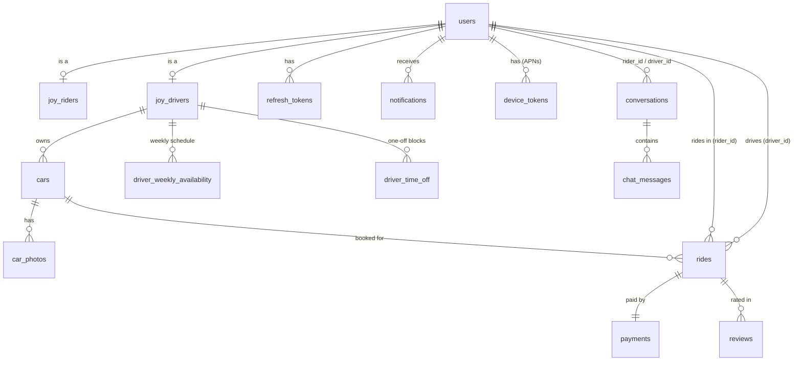
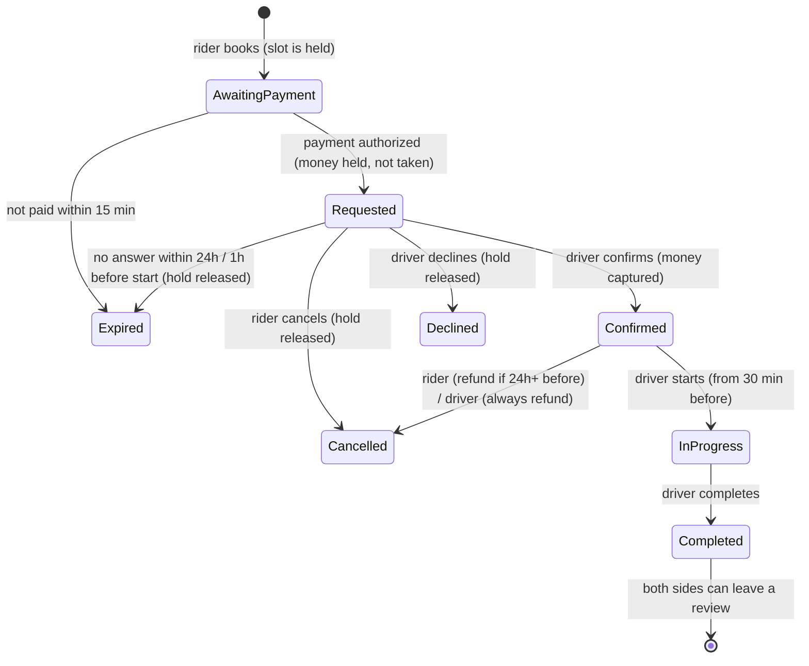

# JOYRIDR API

Backend for **JOYRIDR**: like Uber/Bolt, but you book a *joyride* (djir) in someone's sports car or supercar.

- **JoyRiders** browse cars near them, pick a time from the driver's schedule, choose where to meet, and pay.
- Riders and drivers can **chat** with each other.
- **JoyDrivers** list their cars (an admin approves each one, which keeps the platform sports/supercar only), set a weekly schedule, and confirm or decline ride requests.

Stack: **.NET 10** Web API (controllers) · **EF Core 10** code-first with migrations · **PostgreSQL** · JWT access tokens + rotating refresh tokens.
The iOS app (Swift) lives in [`joyridr-ios`](https://github.com/yesssirskii/joyridr-ios).

---

## Getting started

You need the .NET 10 SDK and PostgreSQL (Homebrew is fine).

```bash
brew services start postgresql@18
createuser -s postgres          # once: the connection string uses the "postgres" role
dotnet run --project joyridr
```

In Development the API **creates the database, applies migrations, and seeds demo data** on startup.

- API: http://localhost:5105
- Swagger UI: http://localhost:5105/swagger
- Scalar (a more modern take on the same docs): http://localhost:5105/scalar
- OpenAPI JSON: http://localhost:5105/openapi/v1.json

To call protected endpoints from Swagger: run `POST /api/auth/login`, copy `accessToken`, click **Authorize** and paste it (without the word "Bearer"). Swagger remembers it across reloads.

Demo accounts (password `Password123!`):

| Email | Role | Notes |
|---|---|---|
| `rider@joyridr.dev` | JoyRider | |
| `driver@joyridr.dev` | JoyDriver | Zagreb · Porsche 911 GT3, Ferrari 296 GTB (approved), Huracán STO (pending) · daily 10:00–20:00 |
| `driver2@joyridr.dev` | JoyDriver | Zagreb · Nissan GT-R Nismo · Fri evening + weekends |
| `admin@joyridr.dev` | Admin | Approves cars |

Use a different database? Override the connection string without editing files:

```bash
dotnet user-secrets --project joyridr set ConnectionStrings:Default "Host=localhost;Database=joyridr;Username=me"
```

Run the tests:

```bash
dotnet test
```

## Project layout

```
joyridr/
├── Controllers/   HTTP layer: routes, auth attributes, status codes. Thin: each action calls one service method.
├── Services/      Business logic (booking rules, payments, notifications, schedules...). Throws ApiException for errors.
├── DTOs/          Request/response shapes sent to and from the app (records). Never return entities directly.
├── Models/        EF Core entities, i.e. the database tables
│   └── Enums/       RideStatus, CarCategory, UserRole...
├── Data/
│   ├── AppDbContext.cs
│   ├── Configurations/  Fluent EF config per entity (keys, indexes, check constraints)
│   ├── Migrations/      Generated by `dotnet ef` (+ one hand-written constraint, see below)
│   └── DevSeeder.cs     Demo data for local development
├── Common/        Cross-cutting helpers: errors, options, geo math, auth helpers
└── Program.cs     Wiring (DI, auth, JSON, OpenAPI, controllers)
joyridr.Tests/     xUnit tests for scheduling, geo and pricing
```

A request flows **Controller → Service → AppDbContext**, and comes back **Entity → DTO → JSON**.
The `///` comments on controller actions show up as endpoint descriptions in Swagger.

## Database

Tables use `snake_case`; enums are stored as readable strings. Every user has a row in `users`, plus a row in **either** `joy_riders` or `joy_drivers` that shares the same id.



Things the database enforces itself:

- **No double booking.** An exclusion constraint (`ex_rides_driver_no_overlap`, using `btree_gist`) rejects two active rides for the same driver with overlapping times, even if two riders hit "Book" at the same millisecond. EF can't model this, so it lives in the hand-written `AddRideOverlapConstraint` migration. If you ever change `Ride.BlockingStatuses`, update that SQL too.
- Check constraints: ride end > start, rating 1–5, price > 0, seats 1–8, and so on.
- `rides.xmin` is used as an optimistic concurrency token, so a confirm and a cancel can't both win.

### Migrations workflow (code-first)

```bash
# after changing an entity or configuration:
dotnet ef migrations add AddSomething --project joyridr -o Data/Migrations
dotnet ef database update --project joyridr     # or just run the app in Development
```

## How a ride works



1. The rider searches `GET /api/cars/nearby`. Results are a **list sorted by distance, one row per car** (a driver with two cars appears twice). Each result also has:
   - `isAvailableToday`: the green dot, meaning the driver still has a free slot today in their time zone;
   - `nextAvailableAt`: when their next free slot is (within a week), for "Available tomorrow 10:00";
   - a rounded location, so a map can be added later without revealing anyone's home.
2. The rider opens a car and loads bookable times with `GET /api/cars/{id}/slots?date=2026-10-25&durationMinutes=60`. Slots come from the driver's weekly schedule minus time off and existing rides, on a 30-minute grid in the driver's time zone.
3. The rider books with `POST /api/rides`, choosing a meeting option:
   - `driverComesToRider`: the rider sends their location, which must be inside the driver's `serviceRadiusKm`.
   - `riderComesToDriver`: the driver's base address is revealed once the ride is confirmed.
   - `agreedLocation`: either side can set or change the spot with `PUT /api/rides/{id}/meeting-point`.
4. The driver gets a notification, then calls `confirm` or `decline`.
5. Phone numbers are shared only while a ride is confirmed or in progress.

All the timings (lead time, durations, response window, free-cancellation window) live in the `Rides` section of `appsettings.json`.

## API map

All endpoints except `/api/auth/*` need `Authorization: Bearer <accessToken>`. Full request/response shapes are in Swagger/Scalar.

| Area | Endpoints |
|---|---|
| Auth | `POST /api/auth/register` · `login` · `refresh` · `logout` |
| Me | `GET/PUT /api/me` · `PUT /api/me/rider-profile` · `POST /api/me/avatar` |
| Drivers | `GET/PUT /api/drivers/me` · `GET /api/drivers/me/cars` · `GET /api/drivers/{id}` |
| Schedule | `GET/PUT /api/drivers/me/schedule` · `GET/POST/DELETE /api/drivers/me/time-off` · `GET /api/drivers/{id}/schedule` · `GET /api/cars/{id}/slots` |
| Cars | `GET /api/cars/nearby` · `GET /api/cars/{id}` · `POST/PUT/DELETE /api/cars` · `POST/DELETE /api/cars/{id}/photos` |
| Rides | `POST /api/rides` · `GET /api/rides?view=upcoming\|past\|requests` · `GET /api/rides/{id}` · `POST …/confirm` · `decline` · `cancel` · `start` · `complete` · `PUT …/meeting-point` · `POST …/reviews` |
| Chat | `GET /api/conversations` · `GET …/unread-count` · `POST /api/conversations` · `GET …/{id}` · `GET/POST …/{id}/messages` · `POST …/{id}/read` |
| Notifications | `GET /api/notifications` · `GET …/unread-count` · `POST …/{id}/read` · `POST …/read-all` · `POST/DELETE /api/devices` |
| Admin | `GET /api/admin/cars?status=` · `POST …/{id}/approve` · `reject` · `POST /api/admin/drivers/{id}/verify` |

## Notes for the Swift app

- **Base URL**: the iOS Simulator can reach `http://localhost:5105` directly. If App Transport Security blocks it, add `NSAppTransportSecurity → NSAllowsLocalNetworking = YES` to Info.plist.
- **Auth**: keep both tokens in the **Keychain**. Access tokens last 15 min. On a `401`, call `/api/auth/refresh` once and retry. Each refresh returns a *new* refresh token; the old one is dead (reusing it logs the user out everywhere). If refresh fails, send the user to login.
- **JSON**: properties are camelCase. Enums are camelCase strings (`"joyRider"`, `"awaitingPayment"`), so `enum RideStatus: String, Codable { case awaitingPayment, requested, ... }` just works.
- **Dates** are ISO 8601 and *may include fractional seconds* (`2026-10-25T08:00:00.123+00:00`). `JSONDecoder.DateDecodingStrategy.iso8601` can't parse fractional seconds, so use a custom strategy that tries `ISO8601DateFormatter` with `.withFractionalSeconds` first, then without. Send dates in UTC with `Z`.
- **Schedule times** (`startTime`/`endTime`) are `"HH:mm:ss"` strings in the driver's `timeZoneId`; `date` query parameters are `yyyy-MM-dd`.
- **Errors** are RFC 7807 ProblemDetails: show `title` to the user and switch on `code` (e.g. `slot_unavailable`, `outside_service_area`, `email_taken`). Validation errors come back as `400` with an `errors` dictionary per field.
- **Images**: `photoUrl` / `avatarUrl` are paths like `/uploads/cars/…jpg`; prefix them with the base URL (`AsyncImage(url: URL(string: path, relativeTo: baseURL))`). Upload with `multipart/form-data`, field name `file`.
- **Chat**:
  - **Inbox:** `GET /api/conversations` gives one row per chat, with `unreadCount`. `GET /api/conversations/unread-count` is the badge on the chat icon.
  - **Opening a chat:** "Message driver" on a car screen calls `POST /api/conversations` with `{ "otherUserId": driver.id }`. It returns the existing chat if there is one.
  - **On the chat screen:**
    - load `GET …/{id}/messages` (newest page, oldest first);
    - call `POST …/{id}/read`;
    - then every ~3 s, poll `GET …/{id}/messages?afterMessageId=<newest id you have>` and append the results;
    - to load older messages when the user scrolls up, pass `beforeMessageId=<oldest id you have>`.
  - **Cursor:** use message *ids* as the cursor, not dates, so nothing is skipped or shown twice.
  - **Bubbles:** `isMine` tells you which side to draw each bubble on.
  - **Push:** messages that arrive while the chat is closed come as a push with `type = chatMessage` and a `conversationId`.
- **Push**: after the user allows notifications, send the APNs token to `POST /api/devices` on every launch, and `DELETE /api/devices/{token}` on logout.

Suggested screens: Login/Register (with role picker) · Rider: Nearby list → Car detail → Pick date/duration/slot → Meeting point → Pay/confirm → My rides → Ride detail → Review · Driver: Dashboard (requests) → Ride detail (confirm/decline/start/complete) → My cars (add/edit/photos) → Schedule & time off → Profile · Notifications.

## Not done yet (stubs to replace before launch)

- **Payments** use `FakePaymentProvider` (everything succeeds instantly). The real one is Stripe PaymentIntents with `capture_method=manual`, a webhook that moves rides from `AwaitingPayment` to `Requested`, and Stripe Connect to pay drivers out. `IPaymentProvider` is shaped for this.
- **Push** uses `LoggingPushSender`; needs an APNs implementation.
- **File storage** writes to local disk; swap `IFileStorage` for S3/R2/Azure Blob.
- **Chat** is plain HTTP + polling. Switch to SignalR/WebSockets if it ever feels laggy. There's no filtering of phone numbers yet, so riders could arrange rides off-platform.
- **Ideas** for later: Sign in with Apple, driver licence verification flow, buffer time between rides, auto-closing rides that were confirmed but never started, PostGIS once there are lots of cars, integration tests with Testcontainers, deployment.
